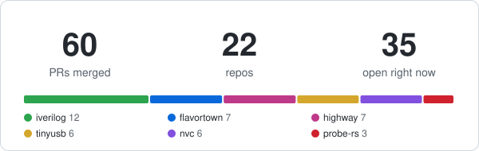
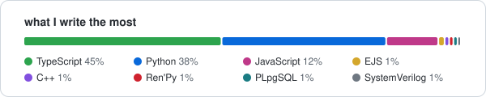

# Heyyy, I'm Anirudh!

### I'm a 18 yr old from India. I like trying things :D

not in a "i'll try this once and move on" way but in a "i'll stay with it long enough to understand how it works" way. I usually start without knowing everything and figure it out as I go!

  
   
  

### over the time things turned into a mix of things:
- building random hardware stuff like a rover, macropad, pcbs and a ECG machine
- mentoring students and working on research
- sketching, music and other creative stuff
- contributing to Hack Club ( my fav reviews, some sidequests, a bit of organizing my own event)
- and somehow even ending up on National Television for KBC and meeting Amitabh Bachchan <3

### I don't really fit into one box, and I'm okay with that. I like exploring different things and seeing how they connect

"jack of all trades, master of none" gets said a lot but I think there's value in being able to connect things across different domains and figure things out from scratch :)
and the full quote is "jack of all trades, master of none, but oftentimes better than master of one" and I like that part a lot :D

## What am i trying to do right now??
just trying to get better at building things that I find interesting and are actually useful to people!

lately that means going down to the low level stuff: verilog simulators, debug probes, usb stacks, bootloaders and risc-v. turns out the best way to learn how a tool works is to find where it breaks and fix it :D

### currently
-  first year ECE at MANIT Bhopal
-  halfway through MIT 6.002 because I want to actually get circuits, not just use them
-  writing my first research paper (more on that soon!!)
-  a leetcode problem every day, thinking it through before I look anything up
-  getting ready for GSoC 2027

### some fixes that got merged
<!-- PRSTATS:START -->
**60** PRs merged into **22** repos · **34** open right now

latest ones:
- [steveicarus/iverilog#1769](https://github.com/steveicarus/iverilog/pull/1769) Support $cast of class handles (2026-11-12)
- [mcu-tools/mcuboot#2940](https://github.com/mcu-tools/mcuboot/pull/2940) boot: bootutil: Don't fail direct-xip boot on one slot read error (2026-11-10)
- [hathach/tinyusb#4401](https://github.com/hathach/tinyusb/pull/4401) cxd56: fix spresense bsp build and add it to the CI matrix (2026-11-09)
- [hathach/tinyusb#4394](https://github.com/hathach/tinyusb/pull/4394) msc host: validate bNumEndpoints and endpoint bLength in msch_open (2026-11-09)
- [hathach/tinyusb#4400](https://github.com/hathach/tinyusb/pull/4400) code-size: default diff base to origin/master (2026-11-09)

updates by itself every few hours
<!-- PRSTATS:END -->

- **icarus verilog** - [queue writes with `q[$]`](https://github.com/steveicarus/iverilog/pull/1686), [a crash with `?:` on strings](https://github.com/steveicarus/iverilog/pull/1685), [packed struct selects](https://github.com/steveicarus/iverilog/pull/1674), [array address sizing](https://github.com/steveicarus/iverilog/pull/1672)
- **probe-rs** - [DPv3 target ids](https://github.com/probe-rs/probe-rs/pull/4608), [gdb on RV32E chips like the CH32V003](https://github.com/probe-rs/probe-rs/pull/4599), [MCXN RAM aliases](https://github.com/probe-rs/probe-rs/pull/4547)
- **tinyusb** - [iso endpoint checks](https://github.com/hathach/tinyusb/pull/4361), [STM32F401 blackpill](https://github.com/hathach/tinyusb/pull/4368), [oversized network frames](https://github.com/hathach/tinyusb/pull/4369)
- **spike** (the risc-v isa simulator) - [an Sstc interrupt bit](https://github.com/riscv-software-src/riscv-isa-sim/pull/2506)
- and one each in [mcuboot](https://github.com/mcu-tools/mcuboot/pull/2928), [embassy](https://github.com/embassy-rs/embassy/pull/7359), [rp-hal](https://github.com/rp-rs/rp-hal/pull/1016), [cocotb](https://github.com/cocotb/cocotb/pull/5871), [veryl](https://github.com/veryl-lang/veryl/pull/3595) and [nvc](https://github.com/nickg/nvc/pull/1714)

### some things I made
- [macropad](https://github.com/anirudh12032008/macropad) - hand wired, 3d printed case, made from scratch
- [tt-pwm4](https://github.com/anirudh12032008/tt-pwm4-sky26c) - a tiny 4 channel pwm generator for Tiny Tapeout
- [mcuaccel](https://github.com/anirudh12032008/mcuaccel) - an int8 cnn accelerator inside a risc-v soc
- [nyaya](https://github.com/anirudh12032008/nyaya) - legal help for people in MP, in hindi or english
- [recarve](https://github.com/anirudh12032008/recarve) - one person records the lecture, the whole class gets notes

## More about me
-> https://www.anirudhsahu.tech

-> [linkedin](https://www.linkedin.com/in/anirudh-sahu-4b245327b/) if you wanna talk about hardware, open source or literally anything else :D

<picture>
  <source media="(prefers-color-scheme: dark)" srcset="https://raw.githubusercontent.com/anirudh12032008/anirudh12032008/output/snake-dark.svg"/>
  
</picture>

---

*"The best way to predict the future is to build it."*
