  

  
  
  
  

  

### `> about`

18, from India. I like trying things, not in an "once and move on" way but in a "stay with it until I get how it works" way.

- 🔧 hardware: a rover, a macropad, PCBs and an ECG machine
- 🧠 mentoring students and doing research
- 🎨 sketching, music and other creative stuff
- 🛠️ Hack Club: reviews, side quests, organizing my own event
- 📺 somehow ended up on national TV on KBC and met Amitabh Bachchan <3

Right now I live in the low layers: **HDL simulators, debug probes, USB stacks, bootloaders and RISC-V**.

### `> git log --merged`

<b>every merged PR (click to collapse)</b>

| repo | PR | what it does |
|---|---|---|
| ⚡ Spike (RISC-V ISA sim) | [#2506](https://github.com/riscv-software-src/riscv-isa-sim/pull/2506) | clear `hip.VSTIP` when `henvcfg.STCE` is 0 (Sstc) |
| 🔌 probe-rs | [#4608](https://github.com/probe-rs/probe-rs/pull/4608) | read and print TARGETID / DLPIDR for DPv3 |
| 🔌 probe-rs | [#4599](https://github.com/probe-rs/probe-rs/pull/4599) | expose only x0-x15 on RV32E cores (gdb on CH32V003/006) |
| 🔌 probe-rs | [#4547](https://github.com/probe-rs/probe-rs/pull/4547) | mark MCXN RAM alias regions so the RTT scan skips them |
| 🧪 Icarus Verilog | [#1686](https://github.com/steveicarus/iverilog/pull/1686) | support writing to the last queue element with `q[$]` |
| 🧪 Icarus Verilog | [#1685](https://github.com/steveicarus/iverilog/pull/1685) | fix crash with `?:` on a string and `$sformatf()` |
| 🧪 Icarus Verilog | [#1674](https://github.com/steveicarus/iverilog/pull/1674) | out-of-range selects of packed struct members |
| 🧪 Icarus Verilog | [#1672](https://github.com/steveicarus/iverilog/pull/1672) | size the unpacked-array address adder from both operands |
| 🔋 TinyUSB | [#4369](https://github.com/hathach/tinyusb/pull/4369) | drop oversized frames in `net_lwip_webserver` |
| 🔋 TinyUSB | [#4368](https://github.com/hathach/tinyusb/pull/4368) | STM32F401 blackpill chip define + SWO trace |
| 🔋 TinyUSB | [#4361](https://github.com/hathach/tinyusb/pull/4361) | check `usbd_edpt_iso_alloc()` in audio/video drivers |
| 🥾 MCUboot | [#2928](https://github.com/mcu-tools/mcuboot/pull/2928) | fix copy size in `boot_copy_image()` |
| 🦀 rp-hal | [#1016](https://github.com/rp-rs/rp-hal/pull/1016) | keep RP235x `_stack_end` in RAM |
| 🦀 embassy | [#7359](https://github.com/embassy-rs/embassy/pull/7359) | cyw43: make `State` `Send` |
| 🐍 cocotb | [#5871](https://github.com/cocotb/cocotb/pull/5871) | deprecate `get()` / `set()` on value handles |
| 📐 Veryl | [#3595](https://github.com/veryl-lang/veryl/pull/3595) | reject functions with `output` args in port connections |
| 📐 NVC (VHDL) | [#1714](https://github.com/nickg/nvc/pull/1714) | length of a concatenation of two null arrays |

**in review:** MicroPython · LVGL · littlefs · Chisel · Verible · OpenTitan

### `> stack`

  

### `> stats`

  

  

---

<i>"jack of all trades, master of none, but oftentimes better than master of one"</i>

